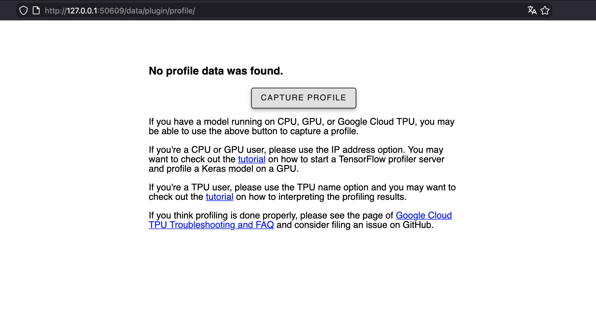

# XProf Kubernetes deployment for Distributed Profiling

This document describes how to deploy XProf in a distributed setup on
Kubernetes, using separate deployments for workers and an aggregator.


## Prerequisites

*   A Kubernetes cluster. For a minimal setup in this tutorial we're using minikube.
*   A Docker image of XProf. See
    [Building an XProf Docker Image](docker_deployment.md) for instructions on
    how to build one.

## Kubernetes Configuration

The following YAML configurations define Kubernetes deployments and services for
XProf workers and an aggregator.

The aggregator deployment runs a single replica that receives user requests and
distributes profiling tasks to the worker replicas using a round-robin policy.
The `--worker_service_address` flag configures the aggregator to send requests
to the worker service.

The worker deployment runs multiple replicas, each exposing a gRPC port via the
`--grpc_port` flag to listen for processing tasks from the aggregator.

**Note**: The port numbers used in the YAML configurations below (e.g., HTTP
port `10000` for the aggregator, gRPC port `8891` for workers) are examples and
can be customized to fit your environment.

**Note**: This configuration uses gRPC's DNS resolver with a headless Kubernetes
service (`clusterIP: None`) for worker discovery and relies on gRPC's
`round_robin` load-balancing policy. This setup is incompatible with Kubernetes
Horizontal Pod Autoscaling (HPA) for worker pods because dynamic changes in
replica counts may not be correctly propagated to the aggregator.

### Aggregator

First let's create `agg.yaml` file and paste the contents:

```yaml
apiVersion: apps/v1
kind: Deployment
metadata:
  name: xprof-aggregator-deployment
  labels:
    app: xprof-aggregator-app
spec:
  replicas: 1
  selector:
    matchLabels:
      app: xprof-aggregator-app
  template:
    metadata:
      labels:
        app: xprof-aggregator-app
    spec:
      containers:
      - name: aggregator-container
        image: xprof:2.21.3
        imagePullPolicy: Never
        env:
        - name: GRPC_LB_POLICY
          value: "round_robin"
        - name: GRPC_DNS_RESOLVER
          value: "native"
        - name: XPROF_HOST
          value: "0.0.0.0"
        args:
          - "--port=10000"
          - "--worker_service_address=dns:///xprof-worker-service.default.svc.cluster.local:8891"
          - "--grpc_port=50051"
          - "--hide_capture_profile_button"
        ports:
        - containerPort: 10000

---
apiVersion: v1
kind: Service
metadata:
  name: xprof-agg-service
  labels:
    app: xprof-aggregator-app
spec:
  selector:
    app: xprof-aggregator-app
  type: NodePort
  ports:
  - protocol: TCP
    port: 80
    targetPort: 10000
    nodePort: 30001
```

**Note**: `xprof` versions after `2.24.2` bind the HTTP server to `127.0.0.1`
by default. Setting `XPROF_HOST: "0.0.0.0"` on `aggregator-container` binds the
aggregator HTTP server across all interfaces without breaking `xprof <= 2.24.2`
(on versions after `2.24.2`, `--host=0.0.0.0` can also be passed in `args`),
while `worker-container` explicitly sets `XPROF_HOST: "127.0.0.1"` to override
the image-level `ENV XPROF_HOST=0.0.0.0` so its unused HTTP port stays bound to
loopback.

**Security Note**: Setting `XPROF_HOST: "0.0.0.0"` (or `--host=0.0.0.0`)
disables loopback `Host`-header enforcement and serves unauthenticated profile
endpoints across all container interfaces. Expose `xprof-agg-service` only
behind cluster network policies, firewall rules, or an authenticating reverse
proxy rather than directly to untrusted networks.

### Worker

Workers bind their gRPC server to `127.0.0.1` by default and restrict
`session_id` access to configured root directories. Distributed Kubernetes
worker pods must set `XPROF_WORKER_HOST=0.0.0.0` and configure `--logdir` or
`XPROF_WORKER_LOGDIR` to their shared volume mount path or
`gs://<bucket>/<prefix>`, or set `XPROF_WORKER_LOGDIR=gs://` when scheme-wide
GCS access is governed by the pod's IAM service account.

For worker we create `worker.yaml` file:

```yaml
apiVersion: apps/v1
kind: Deployment
metadata:
  name: xprof-worker-deployment
  labels:
    app: xprof-worker-app
spec:
  replicas: 4
  selector:
    matchLabels:
      app: xprof-worker-app
  template:
    metadata:
      labels:
        app: xprof-worker-app
    spec:
      containers:
      - name: worker-container
        image: xprof:2.21.3
        imagePullPolicy: Never
        env:
        - name: XPROF_HOST
          value: "127.0.0.1"
        - name: XPROF_WORKER_HOST
          value: "0.0.0.0"
        - name: XPROF_WORKER_LOGDIR
          value: "gs://"
        args:
          - "--port=9999"
          - "--grpc_port=8891"
          - "--hide_capture_profile_button"
        ports:
        - containerPort: 8891

---
apiVersion: v1
kind: Service
metadata:
  name: xprof-worker-service
  labels:
    app: xprof-worker-app
spec:
  selector:
    app: xprof-worker-app
  clusterIP: None
  ports:
  - protocol: TCP
    port: 80
    targetPort: 8891
```

### Minikube setup

To deploy our setup run:

```sh
kubectl apply -f worker.yaml
kubectl apply -f agg.yaml
```

You should be able to inspect deployed objects:

```sh
kubectl get services
```

```
NAME                   TYPE        CLUSTER-IP     EXTERNAL-IP   PORT(S)          AGE
kubernetes             ClusterIP   10.96.0.1      <none>        443/TCP          13h
xprof-agg-service      NodePort    10.96.13.172   <none>        8080:30001/TCP   13h
xprof-worker-service   ClusterIP   None           <none>        80/TCP           13h
```

Now let's connect to our aggregator:

```sh
minikube service xprof-agg-service --url
```

```
http://127.0.0.1:50609
❗  Because you are using a Docker driver on darwin, the terminal needs to be open to run it.
```

Now you can access it in your browser:


