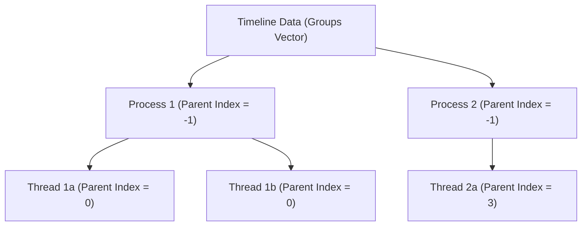

# Trace Viewer V2: Track Hierarchy and Reordering Design Doc

This document explains the data structures, layout hierarchy, and reordering
mechanics used in the Trace Viewer V2 timeline component.

## 1. Overview
Previously, Trace Viewer V2 managed timeline groups (processes, threads, and
counters) as a purely flat sequence. To support collapsible tracks, track
pinning, hiding, and track reordering, the flat list of tracks is organized
into a parent-child tree hierarchy.

## 2. Parent-Child Relationship Representation
Each track is represented by the `Group` struct. Relationships are stored
explicitly:

* **`parent_index`**: The `0`-based index of the parent process in the raw
  `groups` vector, or `-1` if it is a top-level process.
* **`child_indices`**: A list of child indexes (threads or counters) nested
  directly under this group.
* **`has_children`**: A boolean flag indicating if the track has nested
  descendant tracks.

In production, these links are parsed and populated during trace load time
inside `data_provider.cc` (e.g. `PopulateSyncProcessTrack` and
`PopulateCounterTrack`). For mock tests, they are set explicitly in the test
fixture configurations.

## 3. UI Layout and Visibility
The UI relies on two complementary lists:
1. **`groups`**: The actual structured vector containing original indexes and
   parent-child metadata.
2. **`flattened_groups`**: A pre-computed vector of group pointers visited in
   pre-order DFS. Only visible (expanded or un-hidden) tracks are copied into
   the sequence when track management is enabled or standard views are
   updated.

### Collapsed/Expanded State
When a parent track is collapsed (`expanded = false`),
`UpdateLevelPositions()` marks all descendant tracks (whose nesting level
exceeds the parent's level) as `visible = false` and skips their vertical
offset allocation during rendering.

## 4. Track Reordering

When track reordering is enabled (`Timeline::set_track_reordering_enabled`:
behind the `enable_track_management` feature flag in the Trace Viewer, and
always in the Kernel Viewer), hovering a track row reveals a drag handle (three
stacked lines) at the right edge of the label column. Dragging the handle moves
the track, together with its subtree, among its siblings. The handle only
appears on tracks that have a sibling in their section to move around. This
replaces the earlier drag-and-drop prototype, which rebuilt the groups array.

### Data structure: a display permutation, not a data rebuild

Reordering never changes `FlameChartTimelineData`. Group indices, levels,
events, flow lines, counter data, and selections keep referring to the same
groups, so nothing has to be translated. Instead, `TrackOrder`
(`timeline/track_order.h`) produces a permutation of the group indices that
`BuildFlattenedGroups()` uses instead of the natural order, while reordering
is enabled:

1.  **Sibling subtrees**: In DFS pre-order, the subtree of a track is the run
    of tracks right after it with a greater nesting level. `TrackOrder` only
    permutes whole sibling subtrees, so its output is still a valid pre-order.
    Collapsing, pinning, hiding, and the layout pass in
    `UpdateLevelPositions()` keep working unchanged, because they only rely on
    subtrees being contiguous.
2.  **Stable keys**: Incremental fetches replace the timeline data, and with it
    the group indices, while the user pans and zooms. `TrackOrder` therefore
    keys the order by track identity: a parent is identified by the path of
    track names from its root, and a child by its name plus an ordinal that
    tells apart siblings with the same name.
3.  **Stored order per parent**: For each parent with reordered children,
    `TrackOrder` stores the full list of its children, including children that
    are absent from the current data. A track that disappears for a while (for
    example, because it has no events in the fetched range) returns to its
    place. Children missing from the list (new tracks) go after the ordered
    ones, in their natural order. Moving tracks back to the natural order drops
    the list, so the common case stays on the identity fast path.
4.  **Other traces**: A stored order is looked up by the exact path of its
    parent first, and then by the names of the tracks on the path (ignoring
    ordinals). For a non-root parent with no match, `TrackOrder` falls back to
    the stored order of a parent at the same depth that is absent from the
    current trace (for example, `/device:TPU:0` of another host) and shares the
    most child track names with it, if any. So a layout also applies to traces
    whose process names differ, without taking the order of another process
    that is in the trace.

Computing the display order sorts the children of every parent and looks up
their stored order. It only runs on layout updates, never per frame, and is
the identity permutation when there is no custom order.

### Interaction

*   **Drag**: Pressing the handle and moving the pointer past the drag
    threshold starts the drag. A track can only be dropped among its siblings
    (same parent and nesting level) in its section (Hidden, Pinned, or All),
    so it never changes parents.
*   **Drop position**: The drop slot is the number of siblings whose vertical
    middle is above the pointer, which leaves no dead zones between rows. An
    accent line with a ring at the siblings' indentation shows the slot. Slots
    right before or after the dragged track are no-ops and show no line.
*   **Feedback**: The dragged track is tinted with the accent color, and a
    card next to the pointer names it. Dragging within 36 px of the top or
    bottom edge auto-scrolls the tracks. On drop, the rows slide to their new
    places through the existing layout transition (unless the user prefers
    reduced motion).
*   **Cancellation**: Pressing **Esc**, a data reload, or disabling reordering
    cancels the drag and deactivates the handle until the next press.
*   **Minimap**: When the minimap is enabled, the schedule minimap
    (`PopulateMinimapScheduleSummary`) lists its lanes and region ribbons in
    the order of the tracks on the canvas.

### Persistence

`TrackOrder::Serialize()` encodes the stored sibling orders as compact JSON,
and `TrackOrder::Deserialize()` reads it back, using defaults for missing
members and skipping unknown ones. `Application` saves the JSON in
`window.localStorage` under a single key (`xprof_track_order`) whenever the
user changes the order, and restores it at startup and before each trace is
loaded. All sessions, browser tabs, and both the Trace Viewer and the Kernel
Viewer share the key under a last-writer-wins policy, so the layout follows the
user from trace to trace. To start over, drag the tracks back or remove the
`xprof_track_order` key from local storage in the browser's developer tools.

### Ordering modes and JavaScript API

`TrackOrder::Mode` selects how siblings are ordered: by the custom order, in
the order of the trace (keeping the custom order, so that it can be restored),
or by name in either direction. Moving a track in another mode first replaces
the custom orders for visited parent tracks with the displayed order, so that no
other track moves, and switches to the custom order. Custom orders for parent
tracks not present in the current trace are preserved. The mode is saved with
the order.

For toolbar controls outside the canvas, the module exposes
`SetTrackOrderMode()`, `ResetTrackOrder()`, `GetTrackOrderState()`,
`GetTrackList()` (all tracks in canvas order, with their parent and section),
and `MoveTrack()`. After each frame in which the track order, its mode,
whether tracks can be reordered, or the canvas track order changed (for
example, because of a drop, a data reload, an ordering mode change, or an
expanded or pinned track), it dispatches one `trackorderchanged` event. Track
IDs from `GetTrackList()` are valid until the timeline data changes, which is
followed by a `trackorderchanged` event after the next frame.
