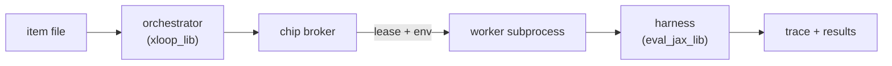

# XLoop Engine

The XLoop Engine is how you answer a question that is surprisingly easy to get
wrong on a TPU: *is this kernel actually faster, and does it still compute the
same thing?*

It is the execution half of an optimisation loop — for a person tuning a
Pallas kernel by hand, or for an agent generating candidates and keeping the
ones that win. You give it a benchmark item containing a reference
implementation and one or two replacements, plus the code that generates their
inputs. It leases a chip per worker, compiles and warms up each
implementation, feeds all of them the same inputs, checks their outputs
against the reference, reads the device execution times back out of the XProf
trace, and leaves the traces behind so you can ask *why*.

```shell
xloop run kernels.jsonl /tmp/run --num_warmups=10 --num_executions=20
```

```
item              status                       correct  custom vs ref  verdict  opt vs ref
----------------  ---------------------------  -------  -------------  -------  ----------
flash_attention   CODE_STATUS_EXECUTE_SUCCESS  pass     1.84x          faster   2.10x
layer_norm        CODE_STATUS_EXECUTE_SUCCESS  FAIL     3.02x          faster   -
```

## Why an engine instead of a script

Three things go wrong with the thirty-line benchmark script everyone writes
first, and each one produces numbers that look plausible and point in the
wrong direction:

1.  **Host timing measures the dispatch path, not the kernel.** Wrapping a
    jitted call in `time.perf_counter()` — even with `block_until_ready()` —
    times Python, JAX dispatch, the driver, and a host-device round trip. On a
    v6e that costs about **160 µs**, against **2.5 µs** of actual compute for
    a 1024³ matmul: the kernel is under 2% of the number, and a genuine 100×
    speedup reads as 1.7×. XLoop reads each sample's duration off the device
    plane of the trace instead.
2.  **A broken kernel is often a fast one.** A tile size that drops the tail
    of a reduction or an accumulator in the wrong dtype can easily run 3×
    faster. XLoop checks every sample's output against the reference on the
    exact same generated inputs before reporting a speedup.
3.  **A TPU VM usually has several chips and more than one person on it.** Two
    processes that both call `jax.devices()` collide on chip 0, while seven
    chips sit idle. XLoop brokers chips across the host: a worker leases what
    it needs, sees only those chips, queues when none are free, and releases
    its lease automatically even if `SIGKILL`ed.

## What a run produces

`xloop run` writes a directory per `(item, input_config)` containing the
serialized `XLoopItem` with `execution_results` and `execution_report` filled
in, plus one XProf trace directory per implementation:

```
/tmp/run/
  items.json
  flash_attention/
    seq2048/
      reference_profile/          *.xplane.pb   (block 0)
      custom_profile/             *.xplane.pb   (block 0)
      custom_profile_block1/      *.xplane.pb
      reference_profile_block1/   *.xplane.pb
      results.json
```

When more than one implementation runs, each one's timed samples run in
blocks, and each block writes its own trace (see
[Alternating blocks](#alternating-blocks)).

Each result records how to read its numbers:

*   `execution_report.speedup_noise_band` is the relative band around 1.0
    inside which a speedup is indistinguishable from run-to-run noise. It is
    at least 2% and widens with the spread of the samples, up to 10%.
*   `execution_report.verdict` is `faster`, `slower` or `no change`. A
    `faster` or `slower` verdict needs two things: the reference-over-custom
    speedup is outside that band, and the 95% interval on the median
    per-sample speedup (`speedup_interval_low` to `speedup_interval_high`)
    does not include 1.0. The interval comes from the order of the per-sample
    ratios, so a few slow samples, such as a slow first sample, cannot make a
    verdict alone. With fewer than 6 samples there is no interval, and only
    stable samples can give a verdict other than `no change`.
    `execution_report.verdict_note` says why a speedup outside the band is
    still `no change`.
*   `execution_results[<config>].timing_source` says, per role, whether the
    times were read off the device trace (`trace`) or measured around the
    dispatch on the host (`wall_clock`). Only trace times resolve a
    microbenchmark.
*   `execution_results[<config>].environment` records the host, the Python,
    JAX, jaxlib, libtpu and XProf versions, the device kind, count and
    topology, and the compiler flags from `XLA_FLAGS` and `LIBTPU_INIT_ARGS`.
    Compare two results only when their environments match.

The traces are ordinary XProf log directories, and `trace_dirs` in the output
maps each `<config>/<role>` to its path. Point `xprof` at them to move from
*whether* a candidate is faster to *why*:

Question                                         | Tool
:----------------------------------------------- | :---
Which kernel dominates device time?              | `get_kernel_stats`
Which HLO ops cost the most?                     | `get_hlo_stats`, `get_top_hlo_ops`
Is it compute-bound or bandwidth-bound?          | `get_roofline_model`
Is the output numerically sound, not just close? | `verify_numerical_parity`

Pallas kernels appear in the device plane as `tpu_custom_call` with their HLO
op names intact.

> [!NOTE]
> `get_llo_analysis` and `get_llo_debug_string` will find nothing in traces
> collected on a Cloud TPU VM: they read an `llo_proto` XStat off the
> `/host:metadata` plane, and the GCE `libtpu` does not emit one.

## Writing an item

An item file is JSON, JSONL, textproto, or binary proto holding one or more
`XLoopItem` messages (defined in `protobuf/xloop_item.proto`). Each item
carries the source text of up to three implementations — `reference_code`,
`custom_code`, `optimized_code` — and one or more named input configurations:

```json
{
  "name": "softmax",
  "kernel_type": "KERNEL_TYPE_JAX",
  "reference_code": "import jax\n\ndef get_model_identifier():\n  return jax.nn.softmax\n",
  "custom_code": "...",
  "input_generation_configs": {
    "r4096_c512": {
      "input_generation_code": "import jax\nimport jax.numpy as jnp\n\ndef get_input_generator():\n  def generate(key):\n    return (jax.random.normal(key, (4096, 512), jnp.bfloat16),), {}\n  return generate\n",
      "atol": 1e-2,
      "rtol": 1e-2
    }
  }
}
```

Each entry in `input_generation_configs` is run and reported separately, so a
single item can sweep shapes or dtypes. Within a config, every implementation
is fed the exact same generated inputs for each sample.

### The module contract

**Implementation code** must define `get_model_identifier()`, returning the
callable to benchmark — a function, a `functools.partial`, a class (which is
instantiated), or a Flax module (whose parameters are initialized and bound).
Two optional attributes on the callable adjust how it is wrapped:

Attribute         | Effect
:---------------- | :-----
`static_argnames` | Forwarded to `jax.jit`, for shape or flag arguments.
`skip_jit`        | Do not wrap in `jax.jit` (for code that already is, or must not be).

If the callable accepts a `config_name` keyword, it receives the active config
name and that argument is marked static automatically, so one kernel can pick
block sizes per shape regime.

**Input-generation code** must define `get_input_generator()`, returning
`generate(key) -> (args, kwargs)`. If `generate` accepts `sample_index`, it
receives the iteration number. The module may also define `get_init_inputs()`
(constructor args when `get_model_identifier()` returns a class) and
`get_atol()` / `get_rtol()` (fallbacks when the config does not set them).

**Shared helpers** go in `auxiliary_modules`, keyed by dotted module name;
they are written into the worker's directory and imported normally.

## CLI reference

```shell
xloop run ITEM_PATH OUTPUT_DIR [flags]
xloop summarize ITEM_PATH [--detailed_summary]
xloop chips
```

Each subcommand prints one JSON object on stdout, so a script can read the
result with a JSON parser. Errors are JSON too, with `status`, `reason` and
`error` keys, and a non-zero exit code.

Flag                   | Default | Effect
:--------------------- | :------ | :-----
`--num_warmups`        | 3       | Untimed iterations before tracing starts.
`--num_executions`     | 10      | Timed samples per implementation.
`--num_blocks`         | 2       | Timed blocks per implementation; see [Alternating blocks](#alternating-blocks).
`--roles`              | all     | Subset of `reference,custom,optimized`.
`--seed`               | 0       | PRNG seed for input generation.
`--tpu_topology`       | 1 chip  | Accelerator shape per worker, e.g. `2x2`.
`--max_local_workers`  | chips   | Cap on concurrent workers.
`--first_config_only`  | false   | Run only the first input config per item.
`--detailed_summary`   | false   | Include per-sample times in the table.
`--in_process`         | false   | Run serially in this process (for a debugger).

## How timing works

Each sample's time is read from the `XLA Modules` line of the `/device:TPU:*`
plane in the `.xplane.pb` trace. The harness runs a small marker op between
samples so consecutive executions of the computation under test are cleanly
separated on the device timeline and can be matched by position.

Only executions of the benchmarked module count. A sample can also run other
modules, for example a `jit__multi_slice` module that moves a sharded input
before the computation. The harness records the module name of the jitted
implementation (such as `jit__matmul`), and `timing_module` reports it per
role. For an implementation with its own jit boundary (`skip_jit`), the name is
not known, and the engine times the module that runs on the most devices.

If a trace cannot be parsed, the engine falls back to wall clock rather than
failing, and records which it used per role in `timing_source` (`"trace"` or
`"wall_clock"`). **Check `timing_source` in any automated loop**: a
`"wall_clock"` result includes the ~160 µs dispatch floor and is not a valid
kernel measurement.

Device time still includes real on-device fixed costs (such as an input copy
or a dtype conversion at the boundary), so `K` back-to-back operations cost
`a + b·K`, not `K·b`.

### Runs on more than one device

A worker can see more than one `/device:TPU:<id>` plane, for example when the
computation is sharded over its chips or a chip has more than one TensorCore.
The engine reads every such plane and aligns each one with the samples on its
own. A computation is done only when its last device is done, so:

*   The time of a sample is the **largest** of its device times.
*   `timing_device` records, per role, the device that was slowest in the most
    samples. Ties go to the device with the lowest id.
*   Each sample's `<role>_device_execution_times_sec` map holds every device's
    time for that sample. The map is empty when there is only one device.
*   A device whose plane holds fewer samples than ran cannot be aligned by
    position, so it is left out. `timing_notes` records, per role, each device
    that was left out and why, and also why a role fell back to wall clock.
    Check it if one device of a run could be slower than the reported time
    shows.

With one device, the reported times are that device's times, as before.

### Alternating blocks

The state of a device can drift during a run, for example its clocks or its
temperature. If every sample of the reference ran before every sample of the
candidate, such a drift would favor the implementation that runs later, even
when the two are identical.

So when more than one implementation runs, the engine splits the timed samples
into `--num_blocks` contiguous blocks (2 by default) and runs the blocks of the
implementations in a balanced order. Even passes go forward through the
implementations and odd passes go backward: `A B B A` for two
implementations, `A B C C B A` for three. A drift that is linear in time then
adds the same time to each implementation.

*   Each implementation is compiled and warmed up just before its first block.
    Before each later block it runs 2 of its warmup samples again, untimed,
    because the other implementations ran in between and changed the device
    caches and possibly the clocks.
*   Each block writes its own trace: block 0 to `<role>_profile`, and block `k`
    to `<role>_profile_block<k>`. `trace_dirs` in the output points to block 0.
*   Each block is aligned with the device trace on its own, with the number of
    samples it ran, and the blocks are joined in sample order. Every
    implementation sees the same inputs in the same positions, so sample `i` of
    the reference still pairs with sample `i` of the candidate.
*   If one block of an implementation cannot be aligned, that implementation
    gets no trace times and falls back to wall clock, with the reason in
    `timing_notes`. A missing block would move every later sample out of its
    pair.
*   A device that is not used in every block is left out, with a note.
*   A single implementation runs in one block, as before.

## How chip sharing works

Each `(item, config)` task runs in its own subprocess holding a lease from the
broker:



A subprocess per task is required because `libtpu` reads its device-selection
variables and `LIBTPU_INIT_ARGS` once at initialization. It also gives each
item a clean compilation cache and contains a `libtpu` segfault to the worker
that caused it.

Leases live in `xloop_chips` under the system temp directory (usually
`/tmp/xloop_chips`, host-global, mode `1777`) as `flock` locks held on open
file descriptors. Each lock file is named by the chip's PCI slot, so a chip
keeps one lease even if its index changes between runs:

*   Because the directory is host-wide rather than per-user, two people on the
    same VM see the same lease state and do not get handed the same chip.
*   Because the lock is tied to the open descriptor, a worker killed with
    `SIGKILL` releases its chip through the kernel the instant it dies.
*   When a worker's environment is constructed, all three `libtpu`
    device-selection variables (`TPU_VISIBLE_DEVICE_PATHS`,
    `TPU_VISIBLE_CHIPS`, `TPU_VISIBLE_DEVICES`) are cleared before setting the
    one for the lease, so an exported variable in the caller's shell cannot
    silently outrank it.
*   A worker is pinned to its chip by device path
    (`TPU_VISIBLE_DEVICE_PATHS`), which works for both `/dev/vfio/*` and
    `/dev/accel*` chips. Only chips from `XLOOP_NUM_CHIPS`, which have no
    device node, are pinned by index (`TPU_VISIBLE_DEVICES`).
*   A run that needs more chips than are currently free waits in FIFO order
    and logs its queue position.

`xloop chips` inspects PCI devices in `/sys/bus/pci/devices` and probes the
lock files without importing JAX — importing JAX would itself claim every
visible chip. A chip counts only if this process can open its device node:
`/dev/vfio/<iommu group>`, or else the `/dev/accelN` node that
`/sys/class/accel` maps to its PCI slot. So a container that exposes a subset
of the host's chips sees only that subset. If the platform has already set one
of the `TPU_VISIBLE_*` variables, discovery keeps only the chips that variable
selects, by the same precedence `libtpu` uses (`TPU_VISIBLE_DEVICE_PATHS`,
then `TPU_VISIBLE_CHIPS`, then `TPU_VISIBLE_DEVICES`). Index entries count the
readable chips in sorted device-path order, as `libtpu` does. A PCI tree that
is missing or unreadable, as in many containers, yields no chips rather than
an error; `XLOOP_NUM_CHIPS` overrides discovery with a fixed count.

If a host runs its own accelerator manager, list its socket or config paths in
`XLOOP_FOREIGN_MANAGER_PATHS` (colon-separated); the broker then refuses to
hand out leases while any of them exists.

The broker is cooperative and exclusive: a lease owns a whole chip for the
duration of the worker, and a non-XLoop process that opens `/dev/vfio/*`
directly is not stopped from doing so (the kernel's single-open rule on a vfio
group is the only hard boundary).
